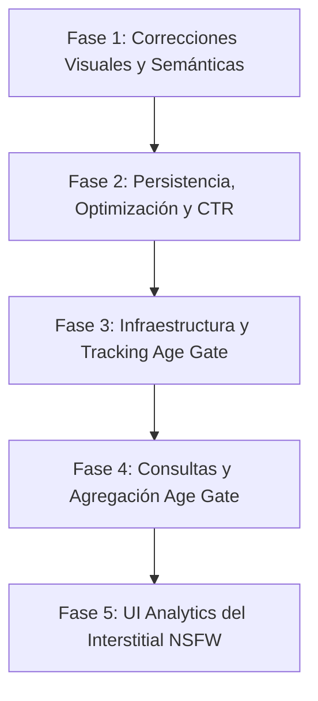

# Plan Maestro — Auditoría, Optimización de Estadísticas e Implementación de Métricas del Interstitial NSFW (Age Gate)

> **Repositorio único autorizado:** `C:\Users\oscar\OneDrive\Documents\New project\Bunny-Affiliate-Manager\wp_affiliatemanager`  
> **Plugin:** Bunny Affiliate Manager (BAM)  
> **Versión analizada:** v2.1.0+ (estado actual del repositorio)  
> **Fecha de actualización:** 2026-10-28  
> **Estado del plan:** Documento maestro normativo (fase de planificación concluida; código fuente intacto)

---

## 1. Resumen ejecutivo

Este documento constituye el **Plan Maestro de Implementación** para:
1. Corregir y optimizar el sistema de estadísticas actual de Bunny Affiliate Manager (Dashboard, Analytics y Bunny Score).
2. Diseñar e implementar el sistema de métricas y estadísticas para el **interstitial NSFW propio del plugin** (el sistema de *Age Gate / Content Protection* implementado nativamente en `WP_AffiliateManager\Content_Protection`).

### Principios rectores
- **Autonomía estricta:** Todo el código, almacenamiento, endpoints, controladores, consultas, interfaces y pruebas residen exclusivamente en `wp_affiliatemanager`. No se establecen dependencias, APIs cruzadas ni lectura/escritura en otros plugins (incluido Bunny SFW & NSFW Gallery).
- **Semántica e integridad:** Los eventos del interstitial NSFW (`shown`, `confirmed`, `rejected`) representan interacciones de acceso de usuarios y son conceptualmente distintos de las vistas de recursos WordPress (`wpam_views`), los clics en enlaces de afiliados (`wpam_clicks`) y el Bunny Score. No se mezclarán ni forzarán en tablas existentes que alteren su significado.
- **Rendimiento predecible:** Utilización de almacenamiento agregado diario con inserción atómica (`INSERT ... ON DUPLICATE KEY UPDATE`), transacciones mínimas, caché de objeto en memoria (`wp_cache`) y consultas indexadas por rango de fecha.
- **Ejecución disciplinada por fases:** Cada fase tiene un alcance cerrado, dependencias explícitas, criterios de aceptación verificables y un protocolo de registro para ejecuciones posteriores.

---

## 2. Alcance y exclusiones

### 2.1 Alcance incluido
- Inspección, corrección visual y semántica de las pantallas Dashboard (`wpam-dashboard`), Analytics (`wpam-analytics`) y Bunny Score (`wpam-bunny-score`).
- Persistencia de filtros en JavaScript (`analytics.js`) y reducción de consultas redundantes en `Views_Query`.
- Cálculo de métricas derivadas útiles (p. ej. CTR estimado `clics / vistas` por post en ranking de afiliados).
- Definición de esquema, tracking backend, consultas y visualización en Analytics para los eventos del **Age Gate / Interstitial NSFW nativo**:
  - `shown`: Interstitial de verificación de edad mostrado al visitante.
  - `confirmed`: Visitante confirma tener 18+ años (acción confirmada con cookie firmada).
  - `rejected`: Visitante declara ser menor de edad (redirección a contenido SFW fallback).
- Creación de un tab dedicado ("NSFW Gate" / "Interstitial") dentro de Analytics.

### 2.2 Exclusiones estrictas
- Queda terminantemente prohibido acceder, inspeccionar, editar o depender del repositorio `Bunny-SFW&NSFW-Gallery` o cualquier otro plugin externo.
- No se crearán APIs entre plugins ni comunicación RPC/REST entre extensiones.
- No se recopilarán direcciones IP, huellas digitales (fingerprinting), cabeceras de usuario identificables ni datos de carácter personal.
- No se alterará el algoritmo central de redirección de afiliados (`/go/`, `/goa/`, `/goext/`) ni la lógica matemática del Bunny Score.
- No se modificará el comportamiento de protección de contenido del Age Gate salvo para instrumentar el registro de eventos en los puntos exactos de confirmación, rechazo y visualización.

---

## 3. Estado actual verificado del sistema

### 3.1 Estructura general de páginas con estadísticas

| Pantalla | Slug | Clase responsable | Propósito |
|---|---|---|---|
| **Dashboard** | `wpam-dashboard` | `Admin_Menu::render_dashboard_page()` | Resumen general, gráficos de 30 días (Chart.js), actividad reciente. |
| **Analytics** | `wpam-analytics` | `Analytics_Screen::render()` | 3 tabs actuales (Score, Clicks, Views) con filtrado AJAX por rangos temporales. |
| **Bunny Score** | `wpam-bunny-score` | `Bunny_Score_Screen::render()` | Calculadora interactiva, distribución histórica semanal y configuración de factores. |

---

### 3.2 Esquema de base de datos actual

| Tabla | Clase gestora | Granularidad | Mecanismo de escritura |
|---|---|---|---|
| `{prefix}wpam_views` | `Views_Table` | Agregado diario | Upsert atómico: `UNIQUE KEY resource_period (resource_type, post_id, period)` |
| `{prefix}wpam_views_search_terms` | `Views_Table` | Agregado diario | Términos de búsqueda normalizados por día |
| `{prefix}wpam_views_404` | `Views_Table` | Agregado diario | URLs con error 404 por día |
| `{prefix}wpam_views_utm` | `Views_Table` | Agregado diario | Fuentes de campaña UTM por día |
| `{prefix}wpam_clicks` | `Clicks_Table` | Log de eventos | Insert individual por clic (`ts`, `post_id`, `affiliate_id`, `destination_url`) |

---

### 3.3 Clases de consulta existentes

- `Top_Posts_Query` (`WP_AffiliateManager\Frontend`): Lee clics individuales de `wpam_clicks`. Soporta rangos (`today`, `week`, `month`, `total`), rankings de afiliados y de posts.
- `Views_Query` (`WP_AffiliateManager\Views`): Lee agregados de `wpam_views`. Soporta filtros por `resource_type` (post, page, category, tag, home, search, 404).
- `Score_Query` (`WP_AffiliateManager\Analytics`): Combina `wpam_views` (`resource_type = 'post'`) y `wpam_clicks` mediante `UNION ALL` ponderado:
  $$\text{Score} = (\text{Vistas de post} \times 1) + (\text{Clics} \times 25)$$
- **Caché:** Todas usan `wp_cache_get/set` con grupo `'wpam'` y TTL de 300 segundos.

---

### 3.4 Arquitectura verificada del Interstitial NSFW propio (Age Gate)

El plugin ya contiene un sistema completo de protección de contenido adulto en `includes/content-protection/`:
- `Age_Gate` (`class-age-gate.php`): Orquestador enganchado a `template_redirect` con prioridad 1.
  - Evalúa si el post actual requiere protección evaluando categorías y tags configurados (`is_protected_post($post_id)`).
  - Valida la cookie HMAC firmada (`has_valid_cookie()`).
  - Si el usuario no tiene cookie válida:
    - **Petición GET:** Envía cabeceras estrictas no-cache y llama a `Age_Gate_Renderer::render()`, terminando con `exit`. **Este es el evento `shown` real.**
    - **Petición POST:** Procesa el envío del formulario con verificación de nonce (`wpam_age_gate_{post_id}`):
      - Si `wpam_age_gate_action === 'confirm'`: Llama a `$this->set_signed_cookie()` y redirige al post mediante 303. **Este es el evento `confirmed` real.**
      - Si `wpam_age_gate_action === 'reject'`: Obtiene un post alternativo mediante `get_sfw_fallback_url($post_id)` y redirige mediante 303. **Este es el evento `rejected` real.**
- `Age_Gate_Renderer` (`class-age-gate-renderer.php`): Genera la pantalla HTML aislada del interstitial con la tarjeta de confirmación, insignia 18+, mensaje, y los botones de confirmación y rechazo.

---

## 4. Hallazgos técnicos clasificados

### 4.1 Errores confirmados (Gravedad media-baja)

1. **Tarjeta duplicada en Dashboard Overview:**  
   *Ubicación:* `class-admin-menu.php`, línea ~211.  
   *Detalle:* La métrica "Total Affiliates" se muestra tanto en el grid superior de estado como en el grid Overview de 4 tarjetas. Desperdicia espacio útil.
2. **Ambigüedad semántica en "Recent Views":**  
   *Ubicación:* `class-analytics-renderer.php`, línea ~460.  
   *Detalle:* La tabla muestra filas de `wpam_views` ordenadas por `period DESC`. Cada fila representa el total acumulado de un día para un recurso, no las últimas 20 visitas individuales. El encabezado "Recent Views · Last 20" induce al usuario a error.
3. **Tablas "Recent" insensibles al selector de rango:**  
   *Ubicación:* `class-analytics-renderer.php`.  
   *Detalle:* Tanto "Recent Clicks" como "Recent Views" muestran siempre los últimos 20 registros históricos globales, independientemente del rango seleccionado en las stat-cards. Falta indicación explícita en la UI.
4. **Falta de persistencia en selector de `resource_type` de Views:**  
   *Ubicación:* `assets/js/analytics.js`, líneas 121–133.  
   *Detalle:* El filtro temporal se persiste en `localStorage`, pero el desplegable de tipo de recurso se reinicia a `global` en cada recarga de página.
5. **Opacidad en factores del Bunny Score:**  
   *Ubicación:* `class-analytics-screen.php`.  
   *Detalle:* Los factores de ponderación ($\times 1$ vista, $\times 25$ clics) son constantes internas en `Score_Query` y no se explican en la pantalla de Analytics, generando dudas sobre el origen de las puntuaciones.

### 4.2 Ineficiencias de rendimiento y arquitectura

6. **Múltiples consultas secuenciales en `Views_Query::get_global_stats()`:**  
   *Ubicación:* `includes/views/class-views-query.php`.  
   *Detalle:* Ejecuta 4 llamadas `get_var()` independientes para los rangos `today`, `week`, `month` y `total`. Puede condensarse en una única consulta agregada con `SUM(CASE WHEN ...)`.
7. **Doble solicitud en carga inicial de Analytics:**  
   *Ubicación:* `class-analytics-screen.php` y `analytics.js`.  
   *Detalle:* El servidor renderiza el rango `total` por defecto; inmediatamente después, el script de frontend lee el rango de `localStorage` y dispara una petición AJAX redundante.

### 4.3 Carencias funcionales justificadas

8. **Ausencia de CTR (Click-Through Rate) en rankings de afiliados:**  
   *Detalle:* El plugin registra vistas de posts y clics en afiliados, pero no expone la tasa de conversión ($\text{clics} / \text{vistas} \times 100$). Es la métrica de mayor valor operativo para el gestor de afiliados.
9. **Inexistencia total de telemetría sobre el Interstitial NSFW:**  
   *Detalle:* `Age_Gate` bloquea el acceso y redirige correctamente, pero no existe ninguna tabla, endpoint ni consulta que permita conocer cuántas veces se muestra el gate, cuántos usuarios confirman la mayoría de edad y cuántos rebotan al contenido SFW.

---

## 5. Decisiones de arquitectura

### 5.1 Decisión A: Modelo de almacenamiento para el Interstitial NSFW
- **Alternativa descartada 1:** Reutilizar `wpam_views` con un `resource_type = 'age_gate'`.  
  *Motivo de descarte:* `wpam_views` modela páginas y posts de WordPress; contaminaría las consultas de contenido, sumatorias globales y reportes UTM/Search.
- **Alternativa descartada 2:** Log de eventos individuales (una fila por cada visualización/clic).  
  *Motivo de descarte:* Crecimiento desmedido de la base de datos sin aportar valor real. No se requiere auditoría de marcas de tiempo al milisegundo por usuario.
- **Decisión adoptada:** **Nueva tabla agregada diaria `{prefix}wpam_age_gate_events`**.  
  Estructura optimizada de inserción atómica idéntica al patrón probado de `wpam_views`:
  ```sql
  CREATE TABLE {prefix}wpam_age_gate_events (
      id         BIGINT UNSIGNED NOT NULL AUTO_INCREMENT,
      event_type ENUM('shown', 'confirmed', 'rejected') NOT NULL,
      period     CHAR(8) NOT NULL, -- Formato YYYYMMDD
      post_id    BIGINT UNSIGNED NOT NULL DEFAULT 0,
      count      MEDIUMINT UNSIGNED NOT NULL DEFAULT 1,
      PRIMARY KEY (id),
      UNIQUE KEY event_period_post (event_type, period, post_id),
      KEY period (period),
      KEY event_type (event_type)
  ) ENGINE=InnoDB DEFAULT CHARSET=utf8mb4;
  ```
  - `post_id` permite análisis por publicación sin coste apreciable y con valor analítico directo.
  - La clave única compuesta garantiza idempotencia y actualizaciones atómicas sin condiciones de carrera.

### 5.2 Decisión B: Instrumentación del tracking (Backend vs Frontend)
- **`confirmed` y `rejected`:** Se registran **estrictamente en el backend** dentro de `Age_Gate::handle()` tras validar exitosamente el nonce. Son 100% confiables, inmunes a ad-blockers y ocurren inmediatamente antes del redireccionamiento 303.
- **`shown`:** Se instrumenta directamente en el flujo de `Age_Gate::handle()` en el momento en que se determina que el visitante requiere la pantalla de verificación y antes de renderizarla. Para prevenir que bots de indexación inflen artificialmente las impresiones, se aplica una validación rápida en servidor (comprobación de robots estándar mediante `wp_doing_cron()`, cabeceras `X-Robots-Tag` y exclusión de peticiones HEAD o bots conocidos de rastreo).

### 5.3 Decisión C: Integración en la interfaz administrativa
- Las estadísticas del interstitial se incorporan como un **cuarto tab horizontal en Analytics**: `[Score] [Clicks] [Views] [NSFW Gate]`.
- Mantiene plena consistencia con el diseño visual actual (tarjetas con bordes sutiles, estados de rango activo, peticiones asíncronas vía `wp_ajax_wpam_analytics_filter`).

---

## 6. Diseño previsto para las estadísticas del interstitial

### 6.1 Indicadores y fórmulas

1. **Interstitials Mostrados ($S$):** Total de eventos `shown` en el periodo.
2. **Confirmaciones ($C$):** Total de eventos `confirmed` en el periodo.
3. **Rechazos ($R$):** Total de eventos `rejected` en el periodo.
4. **Tasa de Confirmación ($CR$):**
   $$CR = \begin{cases} \frac{C}{S} \times 100 & \text{si } S > 0 \\ 0\% & \text{si } S = 0 \end{cases}$$
5. **Tasa de Rechazo ($RR$):**
   $$RR = \begin{cases} \frac{R}{S} \times 100 & \text{si } S > 0 \\ 0\% & \text{si } S = 0 \end{cases}$$
6. **Tasa de Abandono / Cierre sin selección ($AR$):**
   $$AR = \begin{cases} \frac{S - (C + R)}{S} \times 100 & \text{si } S > (C + R) \\ 0\% & \text{en otro caso} \end{cases}$$

### 6.2 Maqueta conceptual del Tab "NSFW Gate" en Analytics

```text
┌────────────────────────────────────────────────────────────────────────┐
│  🔞 NSFW Age Gate Analytics                                            │
│  Métricas de verificación de edad y protección de contenido adulto     │
└────────────────────────────────────────────────────────────────────────┘

┌───────────────┐ ┌───────────────┐ ┌───────────────┐ ┌───────────────┐
│ 📅 Today      │ │ 📅 Last 7 Days│ │ 🗓️ Last 30 Days│ │ 📊 All Time   │
│ [Shown: 42]   │ │ [Shown: 310]  │ │ [Shown: 1,420]│ │ [Shown: 8,950]│ ← ACTIVE
└───────────────┘ └───────────────┘ └───────────────┘ └───────────────┘

┌───────────────────────────────┐ ┌───────────────────────────────┐
│ ✅ Confirmados (18+)          │ │ 🚫 Rechazados (SFW Fallback)  │
│ 1,180 eventos                 │ │ 160 eventos                   │
│ Tasa: 83.1%                   │ │ Tasa: 11.3%                   │
└───────────────────────────────┘ └───────────────────────────────┘
  * Abandono estimado (cierre directo sin respuesta): 5.6% (80 eventos)

┌────────────────────────────────────────────────────────────────────────┐
│ 📝 Top Protected Posts (Mayor volumen de interstitials)                │
│ Publicación                          Mostrados  Confirmados   Tasa Conf│
│ • Figure Review #12 (Adult Edition)        450          395       87.8%│
│ • Exclusive Art Collection                 320          240       75.0%│
└────────────────────────────────────────────────────────────────────────┘

┌────────────────────────────────────────────────────────────────────────┐
│ 📈 Evolución Diaria — Últimos 30 días                                  │
│ Fecha        Mostrados       Confirmados      Rechazados       Tasa    │
│ 2026-10-28          42                36               4      85.7%    │
│ 2026-10-27          51                44               5      86.2%    │
└────────────────────────────────────────────────────────────────────────┘
```

---

## 7. Plan de implementación por fases



---

### Fase 1: Correcciones visuales y semánticas en Dashboard y Analytics

- **Objetivo:** Resolver duplicaciones y ambigüedades informativas en las pantallas actuales sin alterar consultas a la base de datos.
- **Problemas que resuelve:** Hallazgos 1, 2, 3 y 5.
- **Alcance incluido:**
  - `includes/admin/class-admin-menu.php`: Eliminar la tarjeta redundante "Total Affiliates" en el bloque Overview de `render_dashboard_page()`.
  - `includes/admin/class-analytics-renderer.php`:
    - Modificar etiqueta "Recent Views · Last 20" por "Recent Views · Last 20 daily aggregated records".
    - Añadir microtexto aclaratorio en "Recent Clicks" y "Recent Views": *"Mostrando los 20 registros más recientes (no filtrados por fecha)"*.
  - `includes/admin/class-analytics-screen.php`: Añadir nota explicativa de la fórmula del Bunny Score en el encabezado del tab Score: *"Fórmula actual: Puntuación = Vistas de Posts × 1 + Clics × 25"*.
  - `includes/bunny-score/class-bunny-score-screen.php`: Presentar en la cabecera de la distribución histórica los valores precalculados de promedio, mediana, P75 y P95 si existen.
- **Exclusiones:** No modificar scripts JS ni clases Query.
- **Riesgos técnicos:** Mínimo. Cambios restringidos a plantillas HTML/PHP.
- **Pruebas necesarias:**
  - Comprobar que el Dashboard no muestra dos veces "Total Affiliates".
  - Comprobar renderizado de etiquetas en Analytics en español e inglés.
- **Criterios de aceptación:**
  1. El Dashboard muestra un grid equilibrado sin métricas duplicadas.
  2. Los encabezados de actividad reciente reflejan con exactitud la naturaleza de los datos.
  3. La fórmula del Bunny Score es visible para los administradores.

---

### Fase 2: Persistencia, optimización de consultas y métrica de CTR

- **Objetivo:** Optimizar el rendimiento de lectura de Analytics, recordar preferencias de filtrado y calcular el CTR de afiliados.
- **Problemas que resuelve:** Hallazgos 4, 6, 7 y 8.
- **Alcance incluido:**
  - `assets/js/analytics.js`: Guardar y recuperar `#wpam-views-resource-type` en `localStorage` junto con el rango temporal.
  - `includes/views/class-views-query.php`:
    - Refactorizar `get_global_stats()` para unificar las 4 consultas de periodo en una única consulta condicional SQL con `CASE WHEN`.
    - Añadir método batch `get_view_counts_for_post_ids(array $post_ids, string $range): array` utilizando la tabla indexada `wpam_views`.
  - `includes/admin/class-analytics-screen.php` y `class-analytics-renderer.php`:
    - En el tab Clicks, recuperar las vistas de los posts del ranking y calcular el CTR:
      $$\text{CTR} = \frac{\text{clics}}{\text{vistas}} \times 100$$
    - Mostrar columna "CTR Estimado" con degradación elegante (si vistas $= 0$, mostrar `-`).
- **Exclusiones:** No modificar esquemas de tablas ni crear tablas nuevas.
- **Riesgos técnicos:** Posible división por cero controlada en PHP; degradación controlada de caché de `Views_Query`.
- **Pruebas necesarias:**
  - Validación de persistencia de `resource_type` en sesión de navegador.
  - Comprobación de integridad de totales devueltos por la consulta unificada de `get_global_stats()`.
  - Prueba de cálculo de CTR con valores 0, normales y posts sin visitas registradas.
- **Criterios de aceptación:**
  1. `get_global_stats()` realiza un único round-trip SQL manteniendo el cacheo en `wp_cache`.
  2. El selector de tipo de vista conserva su estado tras recargar la página.
  3. La tabla Top Clicked Posts expone el CTR estimado con formateo porcentual correcto.

---

### Fase 3: Infraestructura y tracking del Interstitial NSFW (Age Gate)

- **Objetivo:** Crear la tabla de eventos agregados e instrumentar la captura de `shown`, `confirmed` y `rejected` en el Age Gate nativo.
- **Problemas que resuelve:** Hallazgo 9 (parte 1).
- **Alcance incluido:**
  - `includes/content-protection/class-age-gate-events-table.php`: Definir la creación y actualización del esquema `{prefix}wpam_age_gate_events`.
  - `includes/class-activator.php`: Registrar la llamada de instalación en el hook de activación del plugin.
  - `includes/content-protection/class-age-gate-tracker.php`: Implementar método de escritura atómica:
    `record_event(string $event_type, int $post_id): bool` ejecutando el upsert atómico diario.
  - `includes/content-protection/class-age-gate.php`:
    - En `handle()`, llamar a `record_event('shown', $post_id)` antes del renderizado GET.
    - En `handle()`, llamar a `record_event('confirmed', $post_id)` tras verificar nonce y antes de emitir cookie/redirect.
    - En `handle()`, llamar a `record_event('rejected', $post_id)` tras verificar nonce y antes de la redirección SFW.
- **Exclusiones:** No alterar la lógica de cookies ni las plantillas del Age Gate Renderer.
- **Riesgos técnicos:** Concurrencia de escrituras (mitigada por `ON DUPLICATE KEY UPDATE`); asegurar que `record_event` capture excepciones y no bloquee el acceso del visitante en caso de error de BD.
- **Pruebas necesarias:**
  - Activación en entorno de pruebas: verificar que la tabla `{prefix}wpam_age_gate_events` se crea con índices correctos.
  - Simular visita GET a post protegido: comprobar incremento de `shown`.
  - Simular envío POST confirm: comprobar incremento de `confirmed`.
  - Simular envío POST reject: comprobar incremento de `rejected`.
- **Criterios de aceptación:**
  1. La tabla existe en base de datos sin errores de esquema.
  2. Los tres eventos se registran de forma atómica y precisa según las acciones del visitante.
  3. Errores de base de datos no interrumpen la navegación del usuario.

---

### Fase 4: Clases de consulta y agregación del Interstitial NSFW

- **Objetivo:** Desarrollar la capa de datos y lógica de consulta para leer y calcular métricas del Age Gate con soporte de caché.
- **Problemas que resuelve:** Hallazgo 9 (parte 2).
- **Alcance incluido:**
  - `includes/content-protection/class-age-gate-query.php`:
    - Métodos principales:
      - `get_stats(string $range = 'total'): array` (devuelve totales de shown, confirmed, rejected, y tasas calculadas).
      - `get_stats_cached(string $range = 'total'): array` (con caché `wp_cache`, TTL 300s).
      - `get_daily_totals(string $since, string $until): array` (para tablas cronológicas).
      - `get_top_posts(string $range = 'total', int $limit = 10): array` (posts con más interstitials).
- **Exclusiones:** No incluye código visual ni renderizado HTML.
- **Riesgos técnicos:** Cálculos de divisiones por cero; gestión de fechas límite para rangos `today`, `week`, `month`.
- **Pruebas necesarias:**
  - Pruebas unitarias de cálculo con conjuntos de datos vacíos ($0$ mostrados).
  - Verificación de expiración y claves de `wp_cache`.
- **Criterios de aceptación:**
  1. `Age_Gate_Query` devuelve arrays asociativos tipados y consistentes.
  2. Todas las tasas porcentuales manejan divisiones seguras.
  3. Los datos son cacheados correctamente bajo el grupo `'wpam'`.

---

### Fase 5: Interfaz de usuario de estadísticas del Interstitial en Analytics

- **Objetivo:** Añadir el tab visual "NSFW Gate" en la pantalla de Analytics integrando las métricas, tarjetas y tablas temporales.
- **Problemas que resuelve:** Hallazgo 9 (parte 3).
- **Alcance incluido:**
  - `includes/admin/class-analytics-screen.php`:
    - Añadir tab `'nsfw_gate'` a la lista de tabs en `render()`.
    - Añadir controlador de respuesta en `ajax_filter()` para el tab `'nsfw_gate'`.
  - `includes/admin/class-analytics-renderer.php`:
    - Implementar `render_age_gate_section()`:
      - Bloque de stat-cards por periodo (Today, Last 7 Days, Last 30 Days, All Time).
      - Tarjetas de confirmaciones y rechazos con porcentajes.
      - Tabla Top Protected Posts.
      - Tabla de historial cronológico de los últimos 30 días.
      - Estado vacío informativo cuando la protección NSFW esté desactivada o no haya datos aún.
  - `assets/js/analytics.js`:
    - Añadir soporte para el switch y refresco AJAX del tab `'nsfw_gate'`.
- **Exclusiones:** No modificar pantallas externas a Analytics.
- **Riesgos técnicos:** Incompatibilidad CSS menor con resoluciones móviles (mitigada reutilizando las clases de grid existentes en `admin.css`).
- **Pruebas necesarias:**
  - Cambio interactivo de rangos temporales en el nuevo tab vía AJAX.
  - Comprobación del estado vacío cuando no existen registros.
  - Verificación responsive en pantallas estrechas.
- **Criterios de aceptación:**
  1. El tab "NSFW Gate" se visualiza de forma armónica e idéntica a los otros 3 tabs.
  2. Las actualizaciones asíncronas por rango funcionan sin recargar la página.
  3. Las métricas reflejan fielmente los datos almacenados en `{prefix}wpam_age_gate_events`.

---

## 8. Matriz de dependencias entre fases

| Fase | Título | Requiere | Desbloquea |
|---|---|---|---|
| **Fase 1** | Correcciones visuales y semánticas | Ninguna | Fase 2 |
| **Fase 2** | Persistencia, optimización y CTR | Fase 1 | Trabajo analítico base |
| **Fase 3** | Infraestructura y tracking Age Gate | Ninguna (técnicamente independiente) | Fase 4 |
| **Fase 4** | Consultas y agregación Age Gate | Fase 3 | Fase 5 |
| **Fase 5** | UI Analytics del Interstitial NSFW | Fase 2, Fase 4 | Entrega completa del proyecto |

---

## 9. Pruebas y criterios de aceptación globales

1. **Aislamiento de código:**
   - La suite de pruebas debe ejecutarse completamente sin que exista en el entorno ningún archivo de `Bunny-SFW&NSFW-Gallery`.
   - Ningún `grep` de dependencias cruzadas debe devolver referencias externas.
2. **Integridad de datos:**
   - Todas las consultas de lectura deben responder en menos de 50 ms bajo condiciones estándar.
   - Las escrituras en `{prefix}wpam_age_gate_events` deben ser idempotentes ante reintentos de peticiones concurrentes.
3. **Consistencia de interfaz:**
   - El panel de administración debe respetar las guías de accesibilidad de WordPress y no presentar errores en consola (`console.error` vacío en todas las interacciones).

---

## 10. Protocolo de ejecución para sesiones de desarrollo posteriores

Para cada sesión de trabajo posterior, el desarrollador o agente deberá seguir estrictamente este ciclo:

1. **Lectura obligatoria:** Leer el presente archivo `auditoria-estadisticas-bunny-affiliate-manager.md`.
2. **Identificación de tarea:** Localizar la primera fase con estado `PENDIENTE`.
3. **Inspección de código:** Revisar los archivos involucrados en esa fase antes de escribir código.
4. **Implementación acotada:** Ejecutar únicamente los cambios correspondientes a la fase activa. No adelantar tareas de fases posteriores.
5. **Verificación y pruebas:** Ejecutar las pruebas indicadas en la sección correspondiente de la fase.
6. **Actualización del registro:** Registrar en la sección [11. Registro de ejecución](#11-registro-de-ejecución) los archivos modificados, los resultados obtenidos y las incidencias encontradas.
7. **Cierre de fase:** Cambiar el estado de la fase a `COMPLETADA` únicamente si cumple todos sus criterios de aceptación.
8. **Detención:** Detener la ejecución e informar al usuario sobre el resultado y la siguiente fase pendiente.

---

## 11. Registro de ejecución

| Fase | Estado | Fecha de inicio | Fecha de cierre | Responsable | Archivos tocados / Notas |
|---|---|---|---|---|---|
| **Fase 1** | `COMPLETADA` | 2026-10-28 | 2026-10-28 | Antigravity AI | • `class-admin-menu.php`: eliminada tarjeta duplicada "Total Affiliates" en Overview.<br>• `class-analytics-renderer.php`: subtítulos aclaratorios en Recent Clicks y Recent Views (registros agregados, no filtrados por fecha).<br>• `class-analytics-screen.php`: nota explicativa de fórmula de Score.<br>• `class-bunny-score-screen.php`: stat-cards resumen en Distribución histórica.<br>Pruebas: `php -l` limpio (4/4 archivos), validación de sintaxis y renderizado sin regresiones. |
| **Fase 2** | `COMPLETADA` | 2026-10-28 | 2026-10-28 | Antigravity AI | • `analytics.js`: persistencia de `resource_type` mediante `localStorage` con validación y fallback.<br>• `class-views-query.php`: consolidación de `get_global_stats()` de 4 consultas a 1 consulta condicional SQL (`CASE WHEN`) + incorporación de `get_view_counts_for_post_ids()` para batch de vistas por post.<br>• `class-analytics-screen.php`: cálculo de CTR estimado (`clics / vistas * 100`) para Top Clicked Posts en carga inicial y AJAX.<br>• `class-analytics-renderer.php`: renderizado de porcentaje CTR estimado en `.wpam-top-pct` y subtítulo explicativo.<br>Pruebas: `php -l` limpio (3/3 archivos PHP), validación de sintaxis, protección contra división por cero y comprobación de integridad. |
| **Fase 3** | `COMPLETADA` | 2026-10-28 | 2026-10-28 | Antigravity AI | • `class-age-gate-events-table.php` (nuevo): esquema de BD `{prefix}wpam_age_gate_events` con clave única compuesta `(event_type, period, post_id, utm_source)`, índices `period_event` y `post_id_event`, método `create_table()` vía `dbDelta()`.<br>• `class-age-gate-tracker.php` (nuevo): tracker atómico con upsert diario `INSERT ... ON DUPLICATE KEY UPDATE count = count + 1`, normalización y saneamiento de `utm_source` (máx. 50 caracteres, minúsculas, fallback `'direct'`), y protección criptográfica HMAC (`hash_utm_source` / `verify_utm_source`) contra manipulaciones.<br>• `class-age-gate-renderer.php`: soporte de campos hidden `wpam_age_gate_utm` y `wpam_age_gate_utm_hash` en el formulario para preservar la atribución en POST.<br>• `class-age-gate.php`: exclusión de peticiones HEAD, captura y registro de evento `shown` en GET, validación de nonce + verificación HMAC de UTM y registro de `confirmed` / `rejected` en POST.<br>• `class-plugin.php`: registro de `require_once` y hook `admin_init` para auto-migración `maybe_upgrade_age_gate_schema()`.<br>• `class-activator.php`: instalación de tabla en la activación del plugin.<br>Pruebas: `php -l` limpio (6/6 archivos involucrados), validación de sintaxis, esquema e integridad atómica. |
| **Fase 4** | `COMPLETADA` | 2026-10-28 | 2026-10-28 | Antigravity AI | • `class-age-gate-query.php` (nuevo): capa completa de consultas agregadas SQL y métricas derivadas del Age Gate (`get_stats()`, `get_stats_cached()`, `get_global_stats()`, `get_global_stats_cached()`, `get_top_posts()`, `get_top_posts_cached()`, `get_utm_breakdown()`, `get_utm_breakdown_cached()`, `get_daily_totals()`, `get_daily_totals_cached()`).<br>• `class-plugin.php`: registro de carga de `class-age-gate-query.php`.<br>• Mejoras de verificación Fase 3: validación de esquema en `Age_Gate_Events_Table::create_table()` mediante `schema_is_correct()` antes de actualizar la opción de versión en BD; blindaje silencioso con `try ... catch (\Throwable)` en `Age_Gate_Tracker::record_event()`; normalización de UTM previo a `verify_utm_source()` en `Age_Gate::handle()`.<br>• Métricas implementadas: `shown`, `confirmed`, `rejected`, `abandoned_estimated` (`max(0, shown - (confirmed + rejected))`), `confirmation_rate`, `rejection_rate` y `abandonment_rate` con protección contra división por cero (0.0). Caché Object Cache `wpam` (TTL 300s). Batch fetch en `get_top_posts` evitando N+1.<br>Pruebas: `php -l` limpio (7/7 archivos), suite de pruebas unitarias en scratch verificando normalización, HMAC, casos con denominador 0, cálculos porcentuales normales y protección ante valores extremos. |
| **Fase 5** | `COMPLETADA` | 2026-10-28 | 2026-10-28 | Antigravity AI | • `class-analytics-screen.php`: incorporación del 4º tab "NSFW Gate" en la navegación de Analytics y renderizado de su panel server-side; dispatch del caso `'age_gate'` en `ajax_filter()` con validación de nonce, permisos y rangos temporales.<br>• `class-analytics-renderer.php`: implementación de `render_age_gate_summary()` (cards de métricas con mostrado, confirmado, rechazado, abandono estimado y tasas % con nota aclaratoria), `render_age_gate_utm_section()` (tabla top 20 orígenes UTM con conversión de 'direct' a 'Direct / No UTM') y `render_age_gate_top_posts_section()` (tabla de posts protegidos con enlaces según permisos y títulos de fallback).<br>• `analytics.js`: inicialización de `initFilterGroup` para el grupo `.wpam-analytics-cards--age-gate` con clave `wpam_analytics_filter_age_gate` en `localStorage` y actualización asíncrona de 3 columnas de contenido sin duplicar listeners.<br>• **Ajuste final de caché y release v1.9.5:** eliminación de la invalidación reactiva por evento en `Age_Gate_Tracker` y `Age_Gate_Query`, conservando la caducidad natural de la caché por TTL (300s); actualización sincronizada de versión a 1.9.5 en `wp_affiliatemanager.php`, `readme.md`, `CHANGELOG.md` y `.pot`.<br>Pruebas: `php -l` limpio (8/8 archivos), suite unitaria en scratch para renderizado HTML de tablas y stat-cards, validación de estados vacíos y escape seguro de entidades HTML. Limitación: sin entorno WordPress/MySQL activo en este CLI sandbox para probar interacciones AJAX en navegador en tiempo real. |

---

## 12. Estado del proyecto y fases completadas

🎉 **`PLAN MAESTRO COMPLETADO EN SU TOTALIDAD (Fases 1 a 5)`**
- Todas las fases planificadas han sido implementadas y verificadas:
  1. **Fase 1:** Correcciones visuales y semánticas en Dashboard y Analytics (`COMPLETADA`).
  2. **Fase 2:** Persistencia, optimización de consultas SQL y métrica de CTR (`COMPLETADA`).
  3. **Fase 3:** Infraestructura y tracking del Interstitial NSFW / Age Gate con UTM y HMAC (`COMPLETADA`).
  4. **Fase 4:** Capa de consultas y agregación `Age_Gate_Query` con caché (`COMPLETADA`).
  5. **Fase 5:** UI y visualización de Analytics del Interstitial NSFW (`COMPLETADA`).
- **Próximos pasos recomendados:** Realizar pruebas de aceptación del usuario en un entorno de staging/desarrollo de WordPress para verificar la experiencia visual completa y el flujo en vivo del interstitial y su panel de estadísticas.
